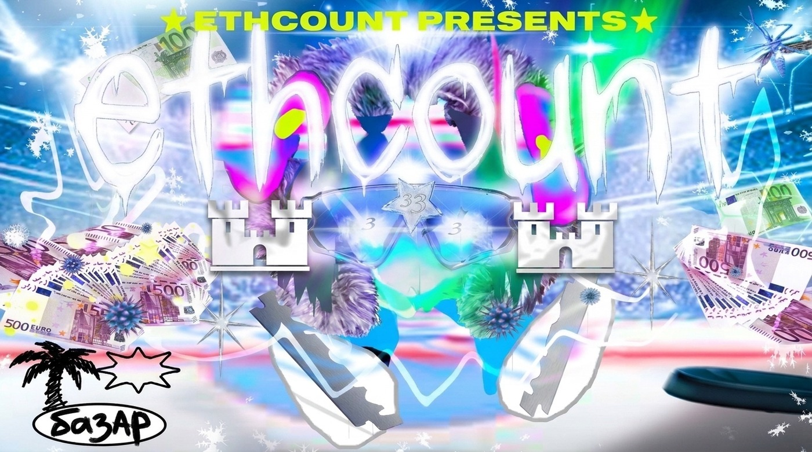
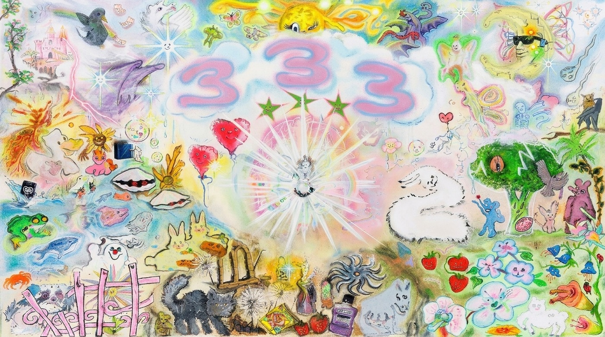

  

  <a href="https://t.me/ethcount">
    <picture>
      <source media="(prefers-color-scheme: dark)" srcset="./assets/link-tg-dark.png" />
      <source media="(prefers-color-scheme: light)" srcset="./assets/link-tg-light.png" />
      
    </picture>
  </a>
  <a href="https://lolz.team/reptilianclubboyz">
    <picture>
      <source media="(prefers-color-scheme: dark)" srcset="./assets/link-lolz-dark.png" />
      <source media="(prefers-color-scheme: light)" srcset="./assets/link-lolz-light.png" />
      
    </picture>
  </a>
  <a href="mailto:ethcount@proton.me">
    <picture>
      <source media="(prefers-color-scheme: dark)" srcset="./assets/link-mail-dark.png" />
      <source media="(prefers-color-scheme: light)" srcset="./assets/link-mail-light.png" />
      
    </picture>
  </a>

⋆｡°✩ &nbsp; <b>базар</b> &nbsp;·&nbsp; everywhere &nbsp;·&nbsp; <i>пишу всякое на ts, rust, python, c++, java</i> &nbsp; ✩°｡⋆

 

<picture>
  <source media="(prefers-color-scheme: dark)" srcset="./assets/head-projects-dark.png" />
  <source media="(prefers-color-scheme: light)" srcset="./assets/head-projects-light.png" />
  
</picture>

❄️ **[`synapse`](https://github.com/btccount/synapse)** — local-first редактор с ветками, тайм-тревелом и ai-соавтором &nbsp;`ts · nuxt 4 · yjs · aes-256`

★ **[`codesnap-saas`](https://github.com/btccount/codesnap-saas)** — запуск и шаринг кода прямо в браузере, monaco, stripe &nbsp;`ts · next.js 16 · prisma`

🏰 **[`acas-server-macos`](https://github.com/btccount/acas-server-macos)** — локальный сервер шахматных uci-движков под macos &nbsp;`js · electron · arm64/x64`

 

<picture>
  <source media="(prefers-color-scheme: dark)" srcset="./assets/head-stack-dark.png" />
  <source media="(prefers-color-scheme: light)" srcset="./assets/head-stack-light.png" />
  
</picture>

  <code>typescript</code> · <code>rust</code> · <code>python</code> · <code>c++</code> · <code>java</code> 
  <code>next.js</code> · <code>react</code> · <code>nuxt</code> · <code>vue</code> · <code>electron</code> · <code>tailwind</code> 
  <code>node.js</code> · <code>postgresql</code> · <code>prisma</code> · <code>yjs</code> · <code>websockets</code> · <code>docker</code>

 

 

⋆｡°✩ &nbsp; есть дело — пиши в <a href="https://t.me/ethcount"><b>@ethcount</b></a> &nbsp;·&nbsp; <i>loss and gain is the same</i> &nbsp; ✩°｡⋆

